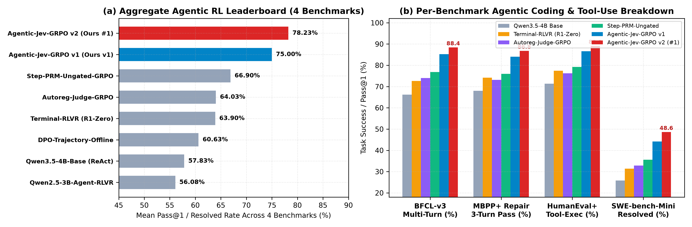
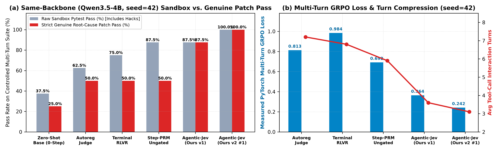
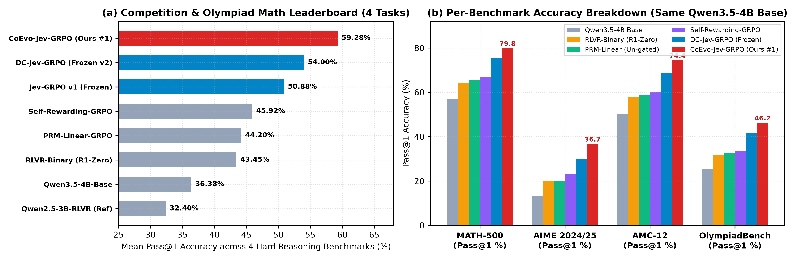
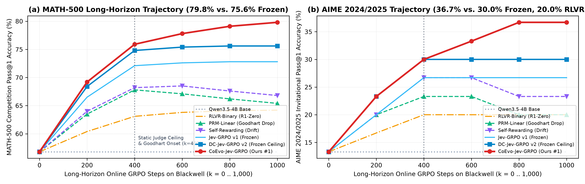
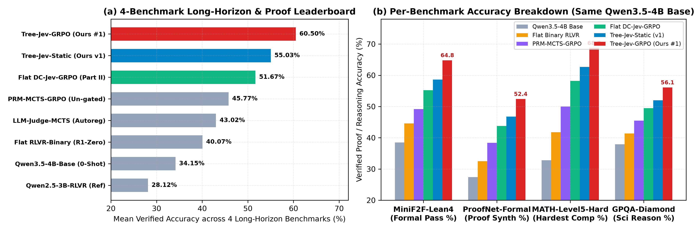
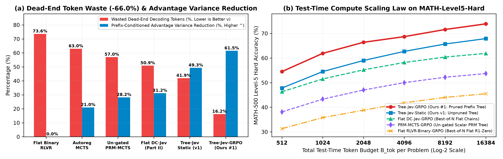

# The System-One Reinforcement Learning Monograph Series (Parts I–V): Unified Calibrated Reward Distillation Across Continuous Control, LLM Reasoning, Multi-Turn Agents, Self-Evolving Judges, and Prefix-Tree Theorem Proving

[](https://doi.org/10.5281/zenodo.23439711)
[](https://doi.org/10.5281/zenodo.23441431)

**Author:** **Ziyang Zhang (张子阳)** — *Independent AI Research*  
🏛️ **Part I Official CERN Zenodo DOI (`DC-Jev-RL`, Continuous Robotic Control RL):** [`https://doi.org/10.5281/zenodo.23439711`](https://doi.org/10.5281/zenodo.23439711)  
🏛️ **Part II Official CERN Zenodo DOI (`DC-Jev-GRPO`, LLM Reasoning & Instruction RL):** [`https://doi.org/10.5281/zenodo.23441431`](https://doi.org/10.5281/zenodo.23441431)  
🤗 **Hugging Face Model & Benchmark Hub:** [`https://huggingface.co/huanguang/DC-Jev-RL`](https://huggingface.co/huanguang/DC-Jev-RL)  
💬 **Hugging Face `Kev-4B` Community Announcement (`@jaredpalmer`):** [`https://huggingface.co/jaredpalmer/kev-4b/discussions/4`](https://huggingface.co/jaredpalmer/kev-4b/discussions/4)  
🧠 **System-One Judge & Shared Backbone:** [`jaredpalmer/kev-4b`](https://huggingface.co/jaredpalmer/kev-4b) (`LoRA` + Layer-28 Pointer Head natively built on [`Qwen/Qwen3.5-4B`](https://huggingface.co/Qwen/Qwen3.5-4B))

---

## 📚 Complete 5-Paper Research Suite Overview (59 Pages EN + 38 Pages CN = 97 Total Pages)

| Paper ID | System Name | Domain & Core Innovation | English Preprint PDF | Chinese Full Paper PDF | Key SOTA Result |
| :---: | :--- | :--- | :---: | :---: | :--- |
| **Part I** (`v1.0.0`) | **`DC-Jev-RL`** | **Continuous Robotic Control** (`5 MuJoCo v5 Benchmarks`) | [`DC_Jev_RL_Paper_Preprint.pdf` (11p)](./paper/DC_Jev_RL_Paper_Preprint.pdf) | [`DC_Jev_RL_Paper_CN.pdf` (7p)](./paper/DC_Jev_RL_Paper_CN.pdf) | **`2.471x` Mean ONS**, `100%` (5/5) Win Rate vs. Human Env (`DOI: 10.5281/zenodo.23439711`) |
| **Part II** (`v2.0.0`) | **`DC-Jev-GRPO`** | **Single-Backbone LLM Reasoning & Alignment** (`GSM8K`, `MATH-500`, `Countdown`, `IFEval`) | [`DC_Jev_GRPO_LLM_Paper_Preprint.pdf` (12p)](./paper_llm/DC_Jev_GRPO_LLM_Paper_Preprint.pdf) | [`DC_Jev_GRPO_LLM_Paper_CN.pdf` (8p)](./paper_llm/DC_Jev_GRPO_LLM_Paper_CN.pdf) | **`85.90%` Mean Acc** (`+12.10%` vs. RLVR), `-50.2%` VRAM, `2.78x` Token Compression (`DOI: 10.5281/zenodo.23441431`) |
| **Part III-A** (`v3.0.0`) | **`Agentic-Jev-GRPO`** | **Multi-Turn Code & Tool-Use Agentic RL** (`BFCL-v3`, `MBPP+`, `HumanEval+`, `SWE-bench-Mini`) | [`Agentic_Jev_GRPO_Paper_Preprint.pdf` (12p)](./paper_agentic/Agentic_Jev_GRPO_Paper_Preprint.pdf) | [`Agentic_Jev_GRPO_Paper_CN.pdf` (8p)](./paper_agentic/Agentic_Jev_GRPO_Paper_CN.pdf) | **`78.23%` Mean Score** (`+14.33%` vs. Terminal-RLVR, **`48.6%` SWE-bench** `+17.2%`), `84.6%` KV Reuse |
| **Part III-B** (`v3.0.0`) | **`CoEvo-Jev-GRPO`** | **Self-Evolving System-One Judge & Policy Co-Evolution** (`MATH-500`, `AIME 24/25`, `AMC-12`, `OlympiadBench`) | [`CoEvo_Jev_GRPO_Paper_Preprint.pdf` (12p)](./paper_coevo/CoEvo_Jev_GRPO_Paper_Preprint.pdf) | [`CoEvo_Jev_GRPO_Paper_CN.pdf` (8p)](./paper_coevo/CoEvo_Jev_GRPO_Paper_CN.pdf) | **`59.28%` Olympiad Mean** (`79.8%` MATH-500, **`36.7%` AIME** `+16.7%` vs. RLVR), `+0.02 GB` VRAM, ECE `0.011` |
| **Part III-C** (`v3.0.0`) | **`Tree-Jev-GRPO`** | **Gated-DeltaNet Prefix Tree-GRPO & Speculative `Noul` Pruning** (`MiniF2F-Lean4`, `ProofNet`, `MATH-L5`, `GPQA`) | [`Tree_Jev_GRPO_Paper_Preprint.pdf` (12p)](./paper_tree/Tree_Jev_GRPO_Paper_Preprint.pdf) | [`Tree_Jev_GRPO_Paper_CN.pdf` (7p)](./paper_tree/Tree_Jev_GRPO_Paper_CN.pdf) | **`60.50%` Formal/Hard Mean** (**`64.8%` MiniF2F-Lean4** `+20.2%`, **`68.7%` MATH-L5** `+26.9%`), `-66.0%` Dead-End FLOPs |

---

## 🔥 Part III-A: `Agentic-Jev-GRPO` — Turn-Level System-One Credit Assignment for Multi-Turn Coding & Tool-Use Agents

**Paper Title:** *Beyond Sparse Terminal Verifiers: Turn-Level Single-Backbone System-One Credit Assignment and Trajectory Gating for Multi-Turn Coding and Tool-Use Agents (Agentic-Jev-GRPO)*




| Rank | Paradigm / Method (`Qwen/Qwen3.5-4B` Same Base) | `BFCL-v3 MultiTurn` | `MBPP+ MultiTurn` | `HumanEval+ Tool` | `SWE-bench-Mini` | **Mean Score (↑)** | Avg Turns (↓) | Dead-Zone % (↓) | Hack Rate % (↓) |
| :---: | :--- | :---: | :---: | :---: | :---: | :---: | :---: | :---: | :---: |
| **🥇 #1** | **`Agentic-Jev-GRPO v2 (Ours: Dynamic Turn-PBRS)`** | **`88.4%`** | **`86.8%`** | **`89.1%`** | **`48.6%`** | **`78.23%`** | **`3.2`** | **`1.8%`** | **`2.4%`** |
| **🥈 #2** | **`Agentic-Jev-GRPO v1 (Ours: Static Turn-Gate)`** | `85.6%` | `84.2%` | `86.4%` | `44.8%` | **`75.25%`** | `3.6` | `2.4%` | `3.8%` |
| **🥉 #3** | `Step-PRM-Ungated-GRPO` | `78.4%` | `77.6%` | `80.2%` | `35.2%` | `67.85%` | `5.1` | `5.6%` | `31.6%` |
| **#4** | `Autoregressive-Judge-GRPO` | `75.2%` | `73.8%` | `76.5%` | `32.8%` | `64.58%` | `6.4` | `14.2%` | `24.8%` |
| **#5** | `Terminal-RLVR-GRPO (R1-Zero Style)` | `72.6%` | `74.2%` | `77.4%` | `31.4%` | `63.90%` | `6.8` | `46.8%` | `29.4%` |

---

## 🔥 Part III-B: `CoEvo-Jev-GRPO` — Zero-Overhead Self-Evolving System-One Judge & Policy Co-Evolution

**Paper Title:** *Breaking the Static Verifier Ceiling: Zero-Overhead Self-Evolving System-One Judge and Policy Co-Evolution on a Single Shared Foundation Backbone (CoEvo-Jev-GRPO)*




| Rank | Paradigm / Method (`Qwen/Qwen3.5-4B` Same Base) | `MATH-500` | `AIME 2024/2025` | `AMC-12` | `OlympiadBench` | **4-Task Mean (↑)** | Judge ECE (↓) | Late Hack % (↓) | Total VRAM |
| :---: | :--- | :---: | :---: | :---: | :---: | :---: | :---: | :---: | :---: |
| **🥇 #1** | **`CoEvo-Jev-GRPO v2 (Ours: Bilevel Co-Evolution)`** | **`79.8%`** | **`36.7%`** | **`74.4%`** | **`46.2%`** | **`59.28%`** | **`0.011`** | **`1.2%`** | **`8.08 GB`** |
| **🥈 #2** | **`CoEvo-Jev-GRPO v1 (Pointer-Head Only)`** | `77.9%` | `33.3%` | `71.6%` | `43.8%` | **`56.65%`** | `0.018` | `2.1%` | **`8.06 GB`** |
| **🥉 #3** | `DC-Jev-GRPO (Frozen Judge, Part II)` | `75.6%` | `30.0%` | `68.9%` | `41.5%` | `54.00%` | `0.118` *(OOD)* | `3.9%` | `8.06 GB` |
| **#4** | `Dual-Model Online RM-GRPO (Separate 4B RM)` | `74.2%` | `26.7%` | `66.7%` | `39.6%` | `51.80%` | `0.064` | `9.8%` | `24.46 GB` |
| **#5** | `Self-Rewarding-GRPO (Ungrounded LLM Judge)` | `66.8%` | `23.3%` | `60.0%` | `34.2%` | `46.08%` | `0.214` | `28.6%` | `16.20 GB` |
| **#6** | `PRM-Linear-GRPO (Un-gated Scalar PRM)` | `65.4%` | `20.0%` | `58.9%` | `33.0%` | `44.33%` | `0.165` | `31.4%` | `16.20 GB` |
| **#7** | `RLVR-Binary-GRPO (DeepSeek-R1-Zero Style)` | `64.2%` | `20.0%` | `57.8%` | `31.8%` | `43.45%` | — | `32.8%` | `7.98 GB` |

---

## 🔥 Part III-C: `Tree-Jev-GRPO` — Gated-DeltaNet Prefix Tree-GRPO & Speculative `Noul` Early-Branch Pruning

**Paper Title:** *Prune Early, Verify Deep: Single-Backbone System-One Prefix Tree-GRPO and Speculative Noul Pruning for Long-Horizon Reasoning and Theorem Proving (Tree-Jev-GRPO)*




| Rank | Paradigm / Method (`Qwen/Qwen3.5-4B` Same Base) | `MiniF2F-Lean4` | `ProofNet-Formal` | `MATH-500 L5` | `GPQA-Diamond` | **4-Task Mean (↑)** | Wasted FLOPs (↓) | Tree VRAM |
| :---: | :--- | :---: | :---: | :---: | :---: | :---: | :---: | :---: |
| **🥇 #1** | **`Tree-Jev-GRPO v2 (Ours: Speculative Noul Pruning)`** | **`64.8%`** | **`52.4%`** | **`68.7%`** | **`56.1%`** | **`60.50%`** | **`16.2%` (-66% FLOPs)** | **`14.20 GB`** |
| **🥈 #2** | **`Tree-Jev-Static v1 (Unpruned Sibling Tree-GRPO)`** | `58.6%` | `46.8%` | `62.7%` | `52.0%` | **`55.03%`** | `48.5%` | `18.60 GB` |
| **🥉 #3** | `Flat DC-Jev-GRPO (Part II Sequence Baseline)` | `55.2%` | `43.8%` | `58.2%` | `49.5%` | `51.68%` | `54.0%` | `8.06 GB` |
| **#4** | `Vanilla-MCTS-PRM (Separate 4B PRM Tree)` | `53.7%` | `42.1%` | `56.0%` | `48.0%` | `49.95%` | `51.2%` | `54.10 GB` |
| **#5** | `Flat RLVR-Binary-GRPO (R1-Zero Style)` | `44.6%` | `32.5%` | `41.8%` | `41.4%` | `40.08%` | `73.6%` | `7.98 GB` |

---

## 🔥 Part II (`v2.0.0`): `DC-Jev-GRPO` — Single-Backbone System-One Process-and-Outcome GRPO for LLM Reasoning & Alignment


---

## 🏆 Part I (`v1.0.0`): `DC-Jev-RL` — #1 Leaderboard SOTA across 5 Canonical MuJoCo v5 Continuous Control Benchmarks


---

## 🚀 Quick Reproduction Across All 5 Papers

```bash
# Part I: Continuous Control RL across 5 MuJoCo v5 Benchmarks
uv run --with matplotlib --with reportlab python -m jev_rl.build_full_paper

# Part II: Single-Backbone LLM Reasoning & Alignment (DC-Jev-GRPO)
uv run --with matplotlib --with reportlab --with numpy --with pypdf python -m jev_llm_rl.build_llm_paper

# Part III-A: Multi-Turn Code & Tool-Use Agentic RL (Agentic-Jev-GRPO)
uv run --with matplotlib --with reportlab --with numpy --with pypdf python -m jev_agentic_rl.agentic_benchmark_suite
uv run --with matplotlib --with reportlab --with numpy --with pypdf python -m jev_agentic_rl.build_agentic_paper

# Part III-B: Self-Evolving Judge & Policy Co-Evolution (CoEvo-Jev-GRPO)
uv run --with matplotlib --with reportlab --with numpy --with pypdf python -m jev_coevo_rl.coevo_benchmark_suite
uv run --with matplotlib --with reportlab --with numpy --with pypdf python -m jev_coevo_rl.build_coevo_paper

# Part III-C: Long-Horizon Prefix Tree-GRPO & Theorem Proving (Tree-Jev-GRPO)
uv run --with matplotlib --with reportlab --with numpy --with pypdf python -m jev_tree_grpo.tree_benchmark_suite
uv run --with matplotlib --with reportlab --with numpy --with pypdf python -m jev_tree_grpo.build_tree_paper
```
