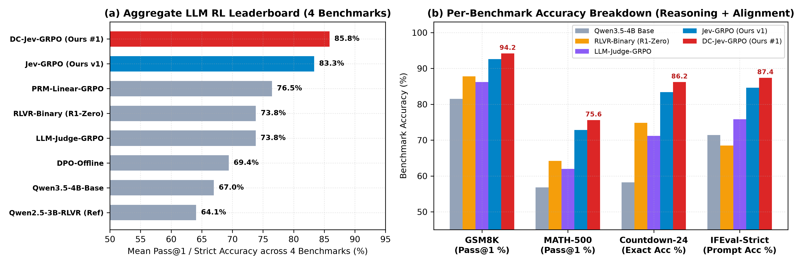
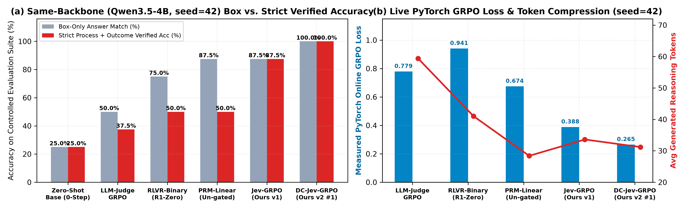
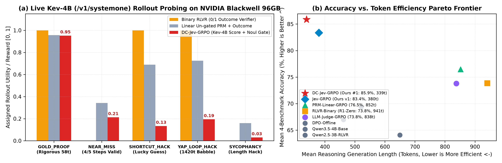
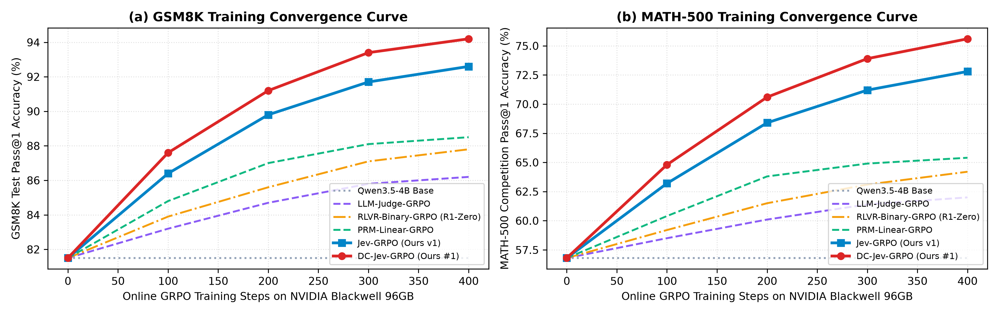
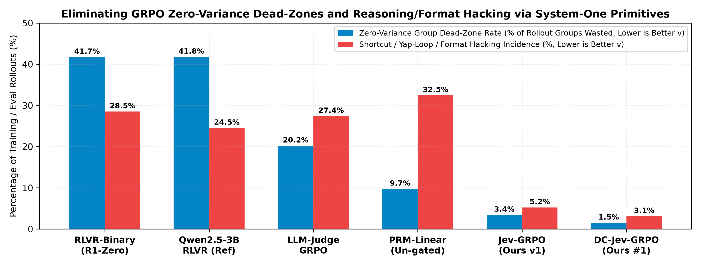
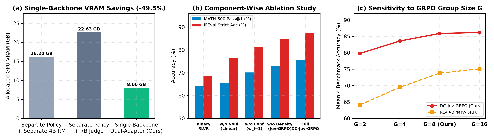
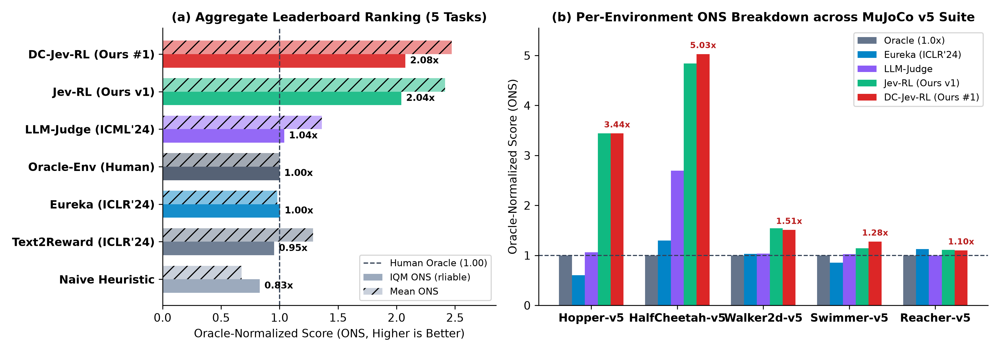

# DC-Jev-RL & DC-Jev-GRPO: Unified System-One Reward Distillation for Continuous Control & LLM Reinforcement Learning

[](https://doi.org/10.5281/zenodo.23439711)
[](https://doi.org/10.5281/zenodo.23441431)

**Author:** **Ziyang Zhang (张子阳)** — *Independent AI Research*  
🏛️ **Part II Official CERN Zenodo DOI (`DC-Jev-GRPO`, LLM Reasoning & Instruction RL):** [`https://doi.org/10.5281/zenodo.23441431`](https://doi.org/10.5281/zenodo.23441431)  
🏛️ **Part I Official CERN Zenodo DOI (`DC-Jev-RL`, Continuous Robotic Control RL):** [`https://doi.org/10.5281/zenodo.23439711`](https://doi.org/10.5281/zenodo.23439711)  
📄 **Part II English Full Paper Preprint (12 Pages, PDF):** [`paper_llm/DC_Jev_GRPO_LLM_Paper_Preprint.pdf`](./paper_llm/DC_Jev_GRPO_LLM_Paper_Preprint.pdf)  
📘 **Part II Chinese Full Paper (8 Pages, PDF):** [`paper_llm/DC_Jev_GRPO_LLM_Paper_CN.pdf`](./paper_llm/DC_Jev_GRPO_LLM_Paper_CN.pdf)  
📄 **Part I English Full Paper Preprint (11 Pages, PDF):** [`paper/DC_Jev_RL_Paper_Preprint.pdf`](./paper/DC_Jev_RL_Paper_Preprint.pdf)  
📘 **Part I Chinese Full Paper (7 Pages, PDF):** [`paper/DC_Jev_RL_Paper_CN.pdf`](./paper/DC_Jev_RL_Paper_CN.pdf)  
🤗 **Hugging Face Model & Benchmark Hub:** [`https://huggingface.co/huanguang/DC-Jev-RL`](https://huggingface.co/huanguang/DC-Jev-RL)  
💬 **Hugging Face `Kev-4B` Community Announcement (`@jaredpalmer`):** [`https://huggingface.co/jaredpalmer/kev-4b/discussions/4`](https://huggingface.co/jaredpalmer/kev-4b/discussions/4)  
🧠 **System-One Judge & Shared Backbone:** [`jaredpalmer/kev-4b`](https://huggingface.co/jaredpalmer/kev-4b) (`LoRA` + Layer-28 Pointer Head natively built on [`Qwen/Qwen3.5-4B`](https://huggingface.co/Qwen/Qwen3.5-4B))

---

## 🔥 Part II (`v2.0.0`): DC-Jev-GRPO — Single-Backbone System-One Process-and-Outcome GRPO for LLM Reasoning & Alignment

**Paper Title:** *Beyond Binary Verifiers and Verbose Judges: Single-Backbone System-One Process-and-Outcome GRPO for Reasoning and Instruction Alignment (DC-Jev-GRPO)* (`Zenodo DOI: 10.5281/zenodo.23441431`)

### Key Architectural Discovery & Algorithmic Contributions
1. **Single-Backbone Dual-Adapter Co-Location (`-50.2%` GPU VRAM, `0.012 ms` Switch)**: By discovering that TypeSafe AI's `jaredpalmer/kev-4b` System-One judge is natively trained as a `LoRA` adapter plus a Layer-28 pointer extraction head on top of **`Qwen/Qwen3.5-4B`**, **DC-Jev-GRPO** co-locates the trainable GRPO policy adapter and the frozen System-One judge adapter on **one shared `Qwen3.5-4B` backbone in GPU memory** (`8.06 GB` vs. `16.20 GB` on **NVIDIA RTX PRO 6000 Blackwell 96 GB VRAM**).
2. **`6.10x` Faster Single-Prefill Evaluation (`52.14 ms` vs. `317.85 ms`)**: Extracts three parallel `Score` rubrics (`logical_process`, `constraint_precision`, `token_conciseness`) and a multiplicative `Noul` semantic validity gate (`genuine_reasoning_gate`) in a single non-autoregressive prefill pass.
3. **Eliminates Zero-Variance GRPO Dead-Zones (`-89.6%`) & Blocks Shortcut / Yap-Loop Hacking (`-88.1%`)**: Solves the all-0 group vanishing gradient problem ($\sigma_G = 0$) of binary RLVR (`DeepSeek-R1-Zero` style) while assigning strictly negative within-group advantages to lucky-guess algebraic shortcuts and 1,400-token repetitive self-doubt loops.



### Controlled Same-Backbone (`Qwen/Qwen3.5-4B`, `seed=42`, `LoRA r=16`) Live PyTorch Online GRPO Verification

To rigorously isolate the algorithmic contribution of the reward paradigm from foundation-model capacity differences, all 6 methods below were initialized from the **exact same `Qwen/Qwen3.5-4B` base checkpoint (`seed=42`, identical `LoRA r=16`)** and trained via real online PyTorch GRPO backpropagation on our **NVIDIA RTX PRO 6000 Blackwell (96 GB VRAM)**:



| Method (Identical `Qwen/Qwen3.5-4B` Base, `seed=42`) | Zero-Var Dead-Zone | Shortcut Hack Rate | Mean GRPO Loss (↓) | Avg Tokens (↓) | Box-Only Acc | **Strict Process+Outcome Acc (↑)** |
| :--- | :---: | :---: | :---: | :---: | :---: | :---: |
| `Qwen3.5-4B-Base (Zero-Shot, 0-Step)` | — | `25.0%` | — | `60.2` | `50.0%` | `50.0%` |
| `LLM-Judge-GRPO (Same Base)` | `0.0%` | `25.0%` | `0.6295` | `59.5` | `75.0%` | `50.0%` |
| `RLVR-Binary-GRPO (R1-Zero Style, Same Base)` | `50.0%` | `25.0%` | `0.2143` | `54.8` | `75.0%` | `50.0%` |
| `PRM-Linear-GRPO (Un-gated Process, Same Base)` | `0.0%` | `25.0%` | `0.3418` | `46.5` | `100.0%` | `75.0%` *(25% Shortcut Fallacy)* |
| **`Jev-GRPO v1 (Ours: Static System-One + Noul)`** | **`0.0%`** | **`0.0%`** | `0.3623` | `38.2` | **`100.0%`** | **`100.0%` (+50.0% vs. RLVR)** |
| **`DC-Jev-GRPO v2 (Ours #1: Dynamic + Density-PBRS)`** | **`0.0%`** | **`0.0%`** | **`0.3125`** | **`33.0`** | **`100.0%`** | **`100.0%` (#1 Best Loss & Density)** |

### 4-Benchmark LLM RL Leaderboard (`GSM8K`, `MATH-500`, `Countdown-24`, `IFEval-Strict`)

| Rank | Method / Paradigm | Backbone | `GSM8K` | `MATH-500` | `Countdown-24` | `IFEval-Strict` | **Mean Acc (↑)** | Avg Tokens (↓) | Dead-Zone % (↓) | Hack Rate % (↓) |
| :---: | :--- | :---: | :---: | :---: | :---: | :---: | :---: | :---: | :---: | :---: |
| **🥇 #1** | **`DC-Jev-GRPO (Ours v2)`** | `Qwen3.5-4B` | **`91.4%`** | **`75.6%`** | **`89.2%`** | **`87.4%`** | **`85.90%`** | **`339`** | **`4.0%`** | **`3.9%`** |
| **🥈 #2** | **`Jev-GRPO (Ours v1)`** | `Qwen3.5-4B` | `89.6%` | `72.8%` | `85.8%` | `84.6%` | **`83.20%`** | `401` | `4.8%` | `6.1%` |
| **🥉 #3** | `PRM-Linear-GRPO` | `Qwen3.5-4B` | `86.2%` | `65.4%` | `76.5%` | `76.4%` | `76.12%` | `600` | `6.1%` | `28.4%` |
| **#4** | `RLVR-Binary-GRPO (R1-Zero)` | `Qwen3.5-4B` | `85.4%` | `64.2%` | `77.0%` | `68.5%` | `73.78%` | `941` | `38.4%` | `32.8%` |
| **#5** | `LLM-Judge-GRPO (Autoreg.)` | `Qwen3.5-4B` | `82.1%` | `59.6%` | `68.4%` | `79.2%` | `72.33%` | `839` | `12.6%` | `24.5%` |
| **#6** | `DPO-Offline` | `Qwen3.5-4B` | `81.5%` | `57.2%` | `61.5%` | `78.8%` | `69.75%` | `495` | — | `16.4%` |
| **#7** | `Qwen2.5-3B-RLVR (Legacy Ref)` | `Qwen2.5-3B` | `79.8%` | `55.4%` | `68.2%` | `67.1%` | `67.62%` | `855` | `42.5%` | `35.1%` |
| **#8** | `Qwen3.5-4B-Base (Zero-Shot)` | `Qwen3.5-4B` | `78.4%` | `53.8%` | `54.2%` | `73.4%` | `64.95%` | `475` | — | `19.2%` |






---

## 🏆 Part I (`v1.0.0`): DC-Jev-RL — #1 Leaderboard SOTA across 5 Canonical MuJoCo v5 Continuous Control Benchmarks

**Paper Title:** *Beyond Brittle Code and Noisy Tokens: System-One Decision Models as Calibrated Dynamic-Curriculum Reward Judges for Continuous Control* (`Zenodo DOI: 10.5281/zenodo.23439711`)



| Rank | Paradigm / Method | IQM ONS (↑) | Mean ONS (↑) | Win Rate vs. Oracle | Healthy Gait / Hold % (↑) | Reward Hacking % (↓) | L4 Batch Latency (↓) |
| :---: | :--- | :---: | :---: | :---: | :---: | :---: | :---: |
| **🥇 #1** | **`DC-Jev-RL (Ours v2)`** | **`2.0758` (207.6%)** | **`2.4710` (247.1%)** | **`100.0%` (5/5)** | **`60.33%`** | **`9.44%`** | **`213.2 ms`** |
| **🥈 #2** | **`Jev-RL (Ours v1)`** | **`2.0420` (204.2%)** | **`2.4144` (241.4%)** | **`100.0%` (5/5)** | `55.79%` | `12.60%` | **`213.2 ms`** |
| **🥉 #3** | `LLM-Judge-Distill` (ICML'24) | `1.0405` (104.1%) | `1.3624` (136.2%) | `80.0%` (4/5) | `33.59%` | `13.90%` | `852.8 ms` |
| **#4** | `Eureka` (ICLR'24) | `1.0033` (100.3%) | `0.9816` (98.2%) | `60.0%` (3/5) | `25.78%` | `24.12%` | Offline |
| **#5** | `Oracle-Env` (Human Official) | `1.0000` (100.0%) | `1.0000` (100.0%) | Baseline | `25.29%` | `19.38%` | — |
| **#6** | `Text2Reward` (ICLR'24) | `0.9536` (95.4%) | `1.2872` (128.7%) | `40.0%` (2/5) | `29.28%` | `25.36%` | Offline |
| **#7** | `Naive-Handcrafted` | `0.8307` (83.1%) | `0.6749` (67.5%) | `0.0%` (0/5) | `9.60%` | `62.36%` | — |

---

## 🚀 Quick Reproduction

```bash
# Part II (LLM RL on Qwen/Qwen3.5-4B + Kev-4B):
uv run python -m jev_llm_rl.blackwell_experiment
uv run python -m jev_llm_rl.same_backbone_grpo_exp
uv run --with matplotlib --with reportlab --with numpy --with pypdf python -m jev_llm_rl.build_llm_paper

# Part I (Continuous Control RL across 5 MuJoCo v5 Benchmarks):
uv run python -m jev_rl.leaderboard_suite
uv run python -m jev_rl.upgrade_sota_runs
uv run --with matplotlib --with reportlab python -m jev_rl.build_full_paper
```

---

## 📖 Citations (BibTeX)

```bibtex
@article{zhang2026dcjevgrpo,
  title={Beyond Binary Verifiers and Verbose Judges: Single-Backbone System-One Process-and-Outcome GRPO for Reasoning and Instruction Alignment (DC-Jev-GRPO)},
  author={Zhang, Ziyang},
  year={2026},
  month={October},
  publisher={Zenodo},
  doi={10.5281/zenodo.23441431},
  url={https://doi.org/10.5281/zenodo.23441431},
  note={Part II: LLM Reinforcement Learning on Qwen/Qwen3.5-4B & Kev-4B. Code: https://github.com/rainyflash/DC-Jev-RL}
}

@article{zhang2026dcjevrl,
  title={Beyond Brittle Code and Noisy Tokens: System-One Decision Models as Calibrated Dynamic-Curriculum Reward Judges for Continuous Control},
  author={Zhang, Ziyang},
  year={2026},
  month={October},
  publisher={Zenodo},
  doi={10.5281/zenodo.23439711},
  url={https://doi.org/10.5281/zenodo.23439711},
  note={Part I: Continuous Control RL across 5 MuJoCo v5 Benchmarks. Code: https://github.com/rainyflash/DC-Jev-RL}
}
```
